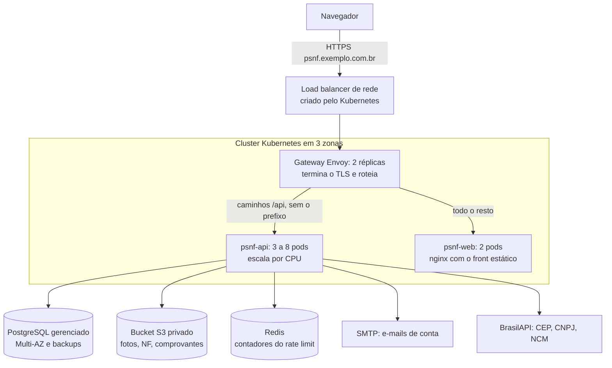

# PSNF em produção: Kubernetes, load balancer e S3

> **Este guia descreve a variante em nuvem (AWS) e não é o caminho escolhido.** A arquitetura em vigor,
> em servidor próprio com 3 nós e só o S3 na nuvem, está em [`docs/arquitetura`](docs/arquitetura/README.md).
> As partes daqui que não dependem de nuvem (imagens, configuração da API, rotas) podem ser reaproveitadas.

Guia passo a passo para publicar a PSNF (API Spring Boot + front React) em Kubernetes, com um load
balancer na entrada, PostgreSQL gerenciado e os arquivos (fotos, notas fiscais, comprovantes) em S3.
A arquitetura foi dimensionada para **até 2.000 usuários ativos ao mesmo tempo**.

Os manifestos Kubernetes valem para qualquer provedor. Onde é preciso escolher um (cluster, banco,
bucket), o exemplo usa a **AWS em São Paulo (`sa-east-1`)**: EKS, RDS e S3. Em outro provedor, troque
só esses três serviços pelos equivalentes.

> **O que foi e o que não foi testado.** Foram verificados: a sintaxe dos manifestos YAML, o build de
> produção do front (`npm run build`) e a inicialização da API com as variáveis de ambiente do
> [passo 6](#6-configuração-e-segredos) (fuso, pool, cookies seguros, usuários de teste desligados).
> As imagens Docker, a instalação no cluster e os comandos da AWS **não foram executados** no ambiente em
> que o guia foi escrito. Os números de capacidade são estimativas calculadas a partir do comportamento
> do código, não de um teste de carga: faça o teste do
> [passo 11](#11-teste-de-carga-antes-de-abrir-para-os-usuários) antes de abrir para os usuários.

## Sumário

- [Arquitetura](#arquitetura)
- [Por que esta arquitetura](#por-que-esta-arquitetura)
- [Dimensionamento para 2.000 usuários](#dimensionamento-para-2000-usuários)
- [Passo a passo](#passo-a-passo)
- [Operação](#operação)
- [Limites conhecidos e próximos passos](#limites-conhecidos-e-próximos-passos)

## Arquitetura



| Componente | O que faz | Réplicas |
| --- | --- | --- |
| Load balancer | Único ponto de entrada da internet; distribui as conexões para o gateway | gerenciado |
| Gateway (Envoy Gateway) | Termina o HTTPS, redireciona HTTP para HTTPS e separa `/api` do front | 2 |
| `psnf-web` | nginx servindo o build estático do React | 2 |
| `psnf-api` | A API Spring Boot, sem estado | 3 a 8 (HPA) |
| PostgreSQL | Dados, busca de texto (`pg_trgm`, `unaccent`) e sessões (refresh tokens) | primário + réplica em espera |
| S3 | Arquivos enviados; o navegador nunca fala com o bucket, só com a API | gerenciado |
| Redis | Contadores do rate limit e das tentativas de senha, iguais para todos os pods | 1 nó + réplica |

## Por que esta arquitetura

Cada decisão abaixo vem de como a aplicação funciona hoje.

- **A API escala na horizontal sem sessão presa.** O login é um JWT em cookie e o refresh token fica no
  banco, então qualquer pod atende qualquer requisição. Não é preciso "sticky session" no load balancer.
  A única exigência é que **todos os pods usem o mesmo `PSNF_JWT_SECRET`**.
- **O rate limit vale para a plataforma inteira.** Os contadores ficam no Redis, então o limite de um
  usuário é o mesmo qualquer que seja o pod que o atenda, e errar a senha em um pod conta nos outros. O
  Redis não guarda nada além disso: se ele cair, a API continua atendendo e cada pod passa a limitar pela
  própria memória até ele voltar.
- **Não há WebSocket.** O chat e os alertas funcionam por consulta periódica (a cada 3 a 30 segundos),
  então um balanceamento HTTP comum basta, e o custo de cada usuário é previsível.
- **O gateway tira o prefixo `/api`.** O front chama `/api/...` e a API responde em `/...`. No
  desenvolvimento quem faz isso é o Vite; em produção, a rota do gateway. Front e API ficam no mesmo
  domínio, o que dispensa CORS e mantém os cookies `HttpOnly` funcionando.
- **Gateway API em vez de Ingress.** A reescrita de caminho faz parte do padrão Gateway API, sem
  anotações específicas de um controlador. O projeto `ingress-nginx`, que era a escolha habitual, foi
  descontinuado em 2026.
- **Banco fora do cluster.** Um PostgreSQL gerenciado entrega réplica em outra zona, failover e backup
  com restauração por horário sem ninguém operar isso à mão. É o componente que mais custa perder.
- **O bucket é privado e só a API o acessa.** As regras de quem pode ver cada arquivo (imagens são
  públicas, PDF e XML exigem login) estão na API. O pod recebe permissão no bucket por papel de IAM, sem
  chave de acesso guardada em lugar nenhum.
- **As migrações rodam sozinhas.** Cada pod aplica o Flyway ao iniciar e uma trava no banco garante que
  só um aplique. As categorias também entram assim.

## Dimensionamento para 2.000 usuários

**Carga estimada.** Um usuário com o chat aberto faz cerca de 25 requisições por minuto (é a referência
usada no rate limit da API). Com 2.000 usuários ativos ao mesmo tempo, o pior caso é de aproximadamente
**830 requisições por segundo**, quase todas leituras curtas. O caso comum fica bem abaixo disso, porque
a consulta de alertas só roda com a aba visível e o chat desacelera quando a conversa esfria.

| Recurso | Configuração inicial | Observação |
| --- | --- | --- |
| Nós do cluster | 3 a 6 nós de 2 vCPU / 8 GB (ex.: `m6i.large`), um por zona | 3 fixos; os demais entram sob demanda |
| `psnf-api` | 3 a 8 pods; pedido de 0,5 vCPU e 1 GiB, limite de 1,5 GiB | escala quando a CPU média passa de 65% |
| `psnf-web` | 2 pods; 0,05 vCPU e 64 MiB | só arquivos estáticos |
| Gateway | 2 pods | um por zona, no mínimo |
| PostgreSQL | 2 vCPU / 8 GB (ex.: `db.m6g.large`), Multi-AZ, 100 GB SSD | aumente a instância se a CPU passar de 60% |
| Redis | 1 nó pequeno (ex.: `cache.t4g.small`) com réplica em outra zona | uma operação por requisição; guarda poucos MB |
| Conexões com o banco | 20 por pod (`PSNF_DB_POOL=20`) | 8 pods × 20 = 160 conexões no máximo |

**Conexões com o banco.** É o limite que mais importa ao escalar. O total de pods vezes o tamanho do
pool precisa ficar abaixo do `max_connections` do PostgreSQL, com folga. Uma instância de 8 GB no RDS
aceita várias centenas de conexões, então 160 cabem. Se um dia o máximo de pods subir muito, coloque um
pool intermediário (PgBouncer ou RDS Proxy) em vez de aumentar o pool de cada pod.

## Passo a passo

Pré-requisitos na sua máquina: `docker`, `kubectl`, `helm` e, no exemplo da AWS, `aws` e `eksctl`.
Os exemplos usam o domínio `psnf.exemplo.com.br` e o namespace `psnf`: troque pelo seu domínio.

### 1. Criar as imagens

O repositório ainda não tem `Dockerfile`. Crie os quatro arquivos abaixo.

`psnf-api/Dockerfile`:

```dockerfile
FROM maven:3.9-eclipse-temurin-21 AS build
WORKDIR /src
COPY pom.xml .
RUN mvn -B -q dependency:go-offline
COPY src src
# os testes precisam de um PostgreSQL: rodam na esteira de CI, não no build da imagem
RUN mvn -B -q package -DskipTests

FROM eclipse-temurin:21-jre
RUN useradd --system --uid 10001 psnf
COPY --from=build /src/target/psnf-0.0.1-SNAPSHOT.jar /app/psnf.jar
USER 10001
# a JVM usa até 70% da memória do container; o resto fica para threads e buffers
ENV JAVA_TOOL_OPTIONS="-XX:MaxRAMPercentage=70 -XX:+ExitOnOutOfMemoryError"
EXPOSE 8080
ENTRYPOINT ["java", "-jar", "/app/psnf.jar"]
```

`psnf-api/.dockerignore`:

```
target
http
scripts
```

`psnf-ui/Dockerfile`:

```dockerfile
FROM node:22-alpine AS build
WORKDIR /src
COPY package.json package-lock.json ./
COPY scripts scripts
RUN npm ci
COPY . .
RUN npm run build

FROM nginxinc/nginx-unprivileged:stable-alpine
COPY nginx.conf /etc/nginx/conf.d/default.conf
COPY --from=build /src/dist /usr/share/nginx/html
EXPOSE 8080
```

`psnf-ui/nginx.conf`:

```nginx
server {
    listen 8080;
    root /usr/share/nginx/html;

    gzip on;
    gzip_types text/css application/javascript application/json image/svg+xml;

    # arquivos com hash no nome: o navegador pode guardar para sempre
    location /assets/ {
        add_header Cache-Control "public, max-age=31536000, immutable";
        try_files $uri =404;
    }

    # rotas do React (ex.: /ordens/123): devolve o index.html, sempre revalidado
    location / {
        add_header Cache-Control "no-cache";
        try_files $uri /index.html;
    }
}
```

Crie também um `psnf-ui/.dockerignore` com `node_modules` e `dist`.

Construa e envie as imagens para um registro (no exemplo, o ECR). Use uma tag por versão, nunca `latest`:

```bash
aws ecr create-repository --repository-name psnf-api --region sa-east-1
```

```bash
aws ecr create-repository --repository-name psnf-web --region sa-east-1
```

```bash
aws ecr get-login-password --region sa-east-1 | docker login --username AWS --password-stdin <CONTA>.dkr.ecr.sa-east-1.amazonaws.com
```

```bash
docker build -t <CONTA>.dkr.ecr.sa-east-1.amazonaws.com/psnf-api:1.0.0 psnf-api
```

```bash
docker build -t <CONTA>.dkr.ecr.sa-east-1.amazonaws.com/psnf-web:1.0.0 psnf-ui
```

```bash
docker push <CONTA>.dkr.ecr.sa-east-1.amazonaws.com/psnf-api:1.0.0
```

```bash
docker push <CONTA>.dkr.ecr.sa-east-1.amazonaws.com/psnf-web:1.0.0
```

### 2. Criar o cluster

Três nós em três zonas, podendo chegar a seis:

```bash
eksctl create cluster --name psnf --region sa-east-1 --managed --nodegroup-name apps --node-type m6i.large --nodes 3 --nodes-min 3 --nodes-max 6
```

Instale os dois complementos de que o guia depende. O `metrics-server` alimenta o escalonamento
automático; o agente de Pod Identity entrega ao pod da API a permissão no bucket:

```bash
kubectl apply -f https://github.com/kubernetes-sigs/metrics-server/releases/latest/download/components.yaml
```

```bash
eksctl create addon --cluster psnf --region sa-east-1 --name eks-pod-identity-agent
```

Para os nós extras entrarem sozinhos sob carga, instale também um escalonador de nós (Cluster Autoscaler
ou Karpenter). Sem ele, o cluster fica nos 3 nós iniciais, que comportam a carga estimada, mas sem folga
para picos.

### 3. Criar o banco e o Redis

**Banco.** Crie um PostgreSQL gerenciado **na mesma rede (VPC) do cluster**, sem endereço público:

| Parâmetro | Valor |
| --- | --- |
| Versão | PostgreSQL 16 ou mais novo |
| Instância | 2 vCPU / 8 GB (`db.m6g.large`) |
| Disponibilidade | Multi-AZ (réplica em espera em outra zona) |
| Disco | 100 GB SSD, com crescimento automático |
| Backup | automático, retenção de 7 dias ou mais |
| Banco inicial | `psnf` |
| Acesso | porta 5432 liberada só para o grupo de segurança dos nós do cluster |

A primeira migração cria as extensões `pg_trgm` e `unaccent`, usadas pela busca de anúncios. O usuário
que a API usa precisa poder criar extensões nesse banco. No RDS, o usuário principal da instância pode.

Guarde o endereço, o usuário e a senha: entram no passo 6.

**Redis.** Guarda só os contadores do rate limit, que expiram sozinhos. Não precisa de backup nem de
disco: se ele reiniciar vazio, os limites recomeçam do zero e ninguém fica bloqueado por engano.

Na AWS, crie um ElastiCache (Redis OSS ou Valkey 7 ou mais novo) na mesma VPC, com um nó
`cache.t4g.small`, uma réplica em outra zona com failover automático, criptografia em trânsito ligada e a
porta 6379 liberada só para os nós do cluster. Guarde o endereço principal para o passo 6.

Fora da AWS, ou para um ambiente de homologação, um Redis dentro do próprio cluster basta. Aplique o
manifesto abaixo depois de criar o namespace (passo 6) e use `PSNF_REDIS_HOST: psnf-redis` e
`PSNF_REDIS_TLS: "false"`:

```yaml
apiVersion: apps/v1
kind: Deployment
metadata:
  name: psnf-redis
  namespace: psnf
spec:
  replicas: 1
  selector:
    matchLabels:
      app: psnf-redis
  template:
    metadata:
      labels:
        app: psnf-redis
    spec:
      containers:
        - name: redis
          image: redis:7-alpine
          # sem gravar em disco; ao encher a memória, descarta os contadores menos usados
          args: ["--save", "", "--appendonly", "no", "--maxmemory", "200mb", "--maxmemory-policy", "allkeys-lru"]
          ports:
            - containerPort: 6379
          resources:
            requests:
              cpu: 50m
              memory: 128Mi
            limits:
              memory: 256Mi
          readinessProbe:
            tcpSocket:
              port: 6379
---
apiVersion: v1
kind: Service
metadata:
  name: psnf-redis
  namespace: psnf
spec:
  selector:
    app: psnf-redis
  ports:
    - port: 6379
```

### 4. Criar o bucket e dar permissão à API

```bash
aws s3api create-bucket --bucket psnf-arquivos-prod --region sa-east-1 --create-bucket-configuration LocationConstraint=sa-east-1
```

```bash
aws s3api put-bucket-versioning --bucket psnf-arquivos-prod --versioning-configuration Status=Enabled
```

Buckets novos já nascem com o acesso público bloqueado: deixe assim. O versionamento permite recuperar
um arquivo apagado ou sobrescrito por engano.

Salve a política abaixo como `psnf-api-s3.json`. A API lê e grava objetos e confere se o bucket existe:

```json
{
  "Version": "2012-10-17",
  "Statement": [
    { "Effect": "Allow", "Action": ["s3:ListBucket"], "Resource": "arn:aws:s3:::psnf-arquivos-prod" },
    { "Effect": "Allow", "Action": ["s3:GetObject", "s3:PutObject"], "Resource": "arn:aws:s3:::psnf-arquivos-prod/*" }
  ]
}
```

```bash
aws iam create-policy --policy-name psnf-api-s3 --policy-document file://psnf-api-s3.json
```

Ligue a política à conta de serviço que o pod da API vai usar (criada no passo 7):

```bash
eksctl create podidentityassociation --cluster psnf --region sa-east-1 --namespace psnf --service-account-name psnf-api --permission-policy-arns arn:aws:iam::<CONTA>:policy/psnf-api-s3
```

**Fora da AWS** (MinIO, Cloudflare R2, outro serviço compatível com S3): em vez da política, informe
`PSNF_STORAGE_ENDPOINT`, `PSNF_STORAGE_ACCESS_KEY` e `PSNF_STORAGE_SECRET_KEY` no passo 6, e use
`PSNF_STORAGE_PATH_STYLE=true` se o serviço exigir.

### 5. Instalar o gateway e o emissor de certificados

O Envoy Gateway implementa o Gateway API e pede ao provedor um load balancer para a sua entrada. O
cert-manager emite e renova o certificado HTTPS pela Let's Encrypt. Em produção, fixe a versão de cada
um com `--version`.

```bash
helm install eg oci://docker.io/envoyproxy/gateway-helm --namespace envoy-gateway-system --create-namespace
```

```bash
helm install cert-manager oci://quay.io/jetstack/charts/cert-manager --namespace cert-manager --create-namespace --set crds.enabled=true --set config.apiVersion=controller.config.cert-manager.io/v1alpha1 --set config.kind=ControllerConfiguration --set config.enableGatewayAPI=true
```

Salve como `gateway-class.yaml` e aplique com `kubectl apply -f gateway-class.yaml`. A anotação pede um
load balancer de rede na AWS; em outros provedores, remova o bloco `envoyService`:

```yaml
apiVersion: gateway.envoyproxy.io/v1alpha1
kind: EnvoyProxy
metadata:
  name: psnf
  namespace: envoy-gateway-system
spec:
  provider:
    type: Kubernetes
    kubernetes:
      envoyDeployment:
        replicas: 2
      envoyService:
        annotations:
          service.beta.kubernetes.io/aws-load-balancer-type: nlb
---
apiVersion: gateway.networking.k8s.io/v1
kind: GatewayClass
metadata:
  name: psnf
spec:
  controllerName: gateway.envoyproxy.io/gatewayclass-controller
  parametersRef:
    group: gateway.envoyproxy.io
    kind: EnvoyProxy
    name: psnf
    namespace: envoy-gateway-system
```

### 6. Configuração e segredos

```bash
kubectl create namespace psnf
```

Salve como `config.yaml` e aplique. São as configurações sem segredo:

```yaml
apiVersion: v1
kind: ConfigMap
metadata:
  name: psnf-api
  namespace: psnf
data:
  # a API grava data e hora sem fuso: todos os pods precisam do mesmo, e o do Brasil
  TZ: America/Sao_Paulo
  SPRING_DATASOURCE_URL: jdbc:postgresql://<ENDERECO-DO-BANCO>:5432/psnf
  PSNF_DB_POOL: "20"
  PSNF_DB_POOL_MIN: "5"
  # S3 da AWS: endpoint e chaves vazios (a permissão vem do papel de IAM do pod)
  PSNF_STORAGE_ENDPOINT: ""
  PSNF_STORAGE_ACCESS_KEY: ""
  PSNF_STORAGE_SECRET_KEY: ""
  PSNF_STORAGE_PATH_STYLE: "false"
  PSNF_STORAGE_REGION: sa-east-1
  PSNF_STORAGE_BUCKET: psnf-arquivos-prod
  # produção: cookies só em HTTPS, sem usuários de teste, IP real do cliente vindo do gateway
  PSNF_COOKIE_SECURE: "true"
  PSNF_USUARIOS_TESTE: "false"
  PSNF_FORWARD_HEADERS: native
  PSNF_FRONT_URL: https://psnf.exemplo.com.br
  # contadores do rate limit; TLS "true" quando o Redis exige criptografia em trânsito
  PSNF_REDIS_HOST: <ENDERECO-DO-REDIS>
  PSNF_REDIS_PORT: "6379"
  PSNF_REDIS_TLS: "true"
  PSNF_SMTP_HOST: <SERVIDOR-SMTP>
  PSNF_SMTP_PORT: "587"
  PSNF_EMAIL_REMETENTE: PSNF <nao-responda@psnf.exemplo.com.br>
```

Três dessas chaves merecem atenção:

- **`TZ`**: sem ela o container roda em UTC e todas as datas aparecem três horas adiantadas na tela.
- **`PSNF_USUARIOS_TESTE=false`**: desliga os usuários `vendedor@mock.psnf` e `comprador@mock.psnf`
  (senha `123456`) e a caixa de e-mails de desenvolvimento. Nunca suba em produção com eles ligados.
- **SMTP**: o cadastro exige confirmação de e-mail. Sem um servidor SMTP configurado, ninguém consegue
  criar conta em produção.

Os segredos não vão para o git. Crie direto no cluster:

```bash
kubectl create secret generic psnf-api --namespace psnf --from-literal=SPRING_DATASOURCE_USERNAME='<USUARIO-DO-BANCO>' --from-literal=SPRING_DATASOURCE_PASSWORD='<SENHA-DO-BANCO>' --from-literal=PSNF_JWT_SECRET="$(openssl rand -base64 48)" --from-literal=PSNF_SMTP_USER='<USUARIO-SMTP>' --from-literal=PSNF_SMTP_PASSWORD='<SENHA-SMTP>'
```

Se o Redis tiver senha, acrescente `--from-literal=PSNF_REDIS_PASSWORD='<SENHA-DO-REDIS>'`.

O `PSNF_JWT_SECRET` assina os logins. Se ele mudar, todos os usuários são deslogados. Se ficar vazio,
cada pod gera o seu e o login deixa de funcionar entre pods.

### 7. Publicar a API

Salve como `api.yaml`, troque `<CONTA>` e aplique com `kubectl apply -f api.yaml`:

```yaml
apiVersion: v1
kind: ServiceAccount
metadata:
  name: psnf-api
  namespace: psnf
---
apiVersion: apps/v1
kind: Deployment
metadata:
  name: psnf-api
  namespace: psnf
spec:
  replicas: 3
  selector:
    matchLabels:
      app: psnf-api
  strategy:
    rollingUpdate:
      maxSurge: 1
      maxUnavailable: 0
  template:
    metadata:
      labels:
        app: psnf-api
    spec:
      serviceAccountName: psnf-api
      terminationGracePeriodSeconds: 45
      # um pod por zona enquanto houver zona disponível
      topologySpreadConstraints:
        - maxSkew: 1
          topologyKey: topology.kubernetes.io/zone
          whenUnsatisfiable: ScheduleAnyway
          labelSelector:
            matchLabels:
              app: psnf-api
      containers:
        - name: api
          image: <CONTA>.dkr.ecr.sa-east-1.amazonaws.com/psnf-api:1.0.0
          ports:
            - containerPort: 8080
          envFrom:
            - configMapRef:
                name: psnf-api
            - secretRef:
                name: psnf-api
          resources:
            requests:
              cpu: 500m
              memory: 1Gi
            limits:
              memory: 1536Mi
          # a API não tem endpoint de saúde próprio: /categorias é público e consulta o banco
          startupProbe:
            httpGet:
              path: /categorias
              port: 8080
            periodSeconds: 5
            failureThreshold: 36
          readinessProbe:
            httpGet:
              path: /categorias
              port: 8080
            periodSeconds: 10
            failureThreshold: 3
          # só a porta: uma queda do banco tira o pod do balanceamento, mas não o reinicia
          livenessProbe:
            tcpSocket:
              port: 8080
            periodSeconds: 20
            failureThreshold: 3
          lifecycle:
            preStop:
              exec:
                command: ["sleep", "10"]
          securityContext:
            runAsNonRoot: true
            allowPrivilegeEscalation: false
            readOnlyRootFilesystem: true
          volumeMounts:
            - name: tmp
              mountPath: /tmp
      volumes:
        # os uploads passam por arquivos temporários
        - name: tmp
          emptyDir: {}
---
apiVersion: v1
kind: Service
metadata:
  name: psnf-api
  namespace: psnf
spec:
  selector:
    app: psnf-api
  ports:
    - port: 80
      targetPort: 8080
---
apiVersion: autoscaling/v2
kind: HorizontalPodAutoscaler
metadata:
  name: psnf-api
  namespace: psnf
spec:
  scaleTargetRef:
    apiVersion: apps/v1
    kind: Deployment
    name: psnf-api
  minReplicas: 3
  maxReplicas: 8
  metrics:
    - type: Resource
      resource:
        name: cpu
        target:
          type: Utilization
          averageUtilization: 65
  behavior:
    scaleDown:
      stabilizationWindowSeconds: 300
---
apiVersion: policy/v1
kind: PodDisruptionBudget
metadata:
  name: psnf-api
  namespace: psnf
spec:
  minAvailable: 2
  selector:
    matchLabels:
      app: psnf-api
```

Confira se os três pods ficaram prontos e se as migrações rodaram:

```bash
kubectl -n psnf rollout status deployment/psnf-api
```

```bash
kubectl -n psnf logs deployment/psnf-api | grep -i -E "flyway|Started Psnf"
```

### 8. Publicar o front

Salve como `web.yaml`, troque `<CONTA>` e aplique:

```yaml
apiVersion: apps/v1
kind: Deployment
metadata:
  name: psnf-web
  namespace: psnf
spec:
  replicas: 2
  selector:
    matchLabels:
      app: psnf-web
  template:
    metadata:
      labels:
        app: psnf-web
    spec:
      containers:
        - name: web
          image: <CONTA>.dkr.ecr.sa-east-1.amazonaws.com/psnf-web:1.0.0
          ports:
            - containerPort: 8080
          resources:
            requests:
              cpu: 50m
              memory: 64Mi
            limits:
              memory: 128Mi
          readinessProbe:
            httpGet:
              path: /
              port: 8080
---
apiVersion: v1
kind: Service
metadata:
  name: psnf-web
  namespace: psnf
spec:
  selector:
    app: psnf-web
  ports:
    - port: 80
      targetPort: 8080
```

### 9. Gateway, rotas e HTTPS

Salve como `gateway.yaml`, troque o domínio e o e-mail, e aplique:

```yaml
apiVersion: cert-manager.io/v1
kind: ClusterIssuer
metadata:
  name: letsencrypt
spec:
  acme:
    server: https://acme-v02.api.letsencrypt.org/directory
    email: <SEU-EMAIL>
    privateKeySecretRef:
      name: letsencrypt-conta
    solvers:
      - http01:
          gatewayHTTPRoute:
            parentRefs:
              - name: psnf
                namespace: psnf
                kind: Gateway
---
apiVersion: gateway.networking.k8s.io/v1
kind: Gateway
metadata:
  name: psnf
  namespace: psnf
  annotations:
    cert-manager.io/cluster-issuer: letsencrypt
spec:
  gatewayClassName: psnf
  listeners:
    - name: http
      protocol: HTTP
      port: 80
      hostname: psnf.exemplo.com.br
    - name: https
      protocol: HTTPS
      port: 443
      hostname: psnf.exemplo.com.br
      tls:
        mode: Terminate
        certificateRefs:
          - name: psnf-tls
---
# HTTP sempre redireciona para HTTPS
apiVersion: gateway.networking.k8s.io/v1
kind: HTTPRoute
metadata:
  name: psnf-redireciona-https
  namespace: psnf
spec:
  parentRefs:
    - name: psnf
      sectionName: http
  rules:
    - filters:
        - type: RequestRedirect
          requestRedirect:
            scheme: https
            statusCode: 301
---
apiVersion: gateway.networking.k8s.io/v1
kind: HTTPRoute
metadata:
  name: psnf
  namespace: psnf
spec:
  parentRefs:
    - name: psnf
      sectionName: https
  rules:
    # /api/anuncios chega na API como /anuncios
    - matches:
        - path:
            type: PathPrefix
            value: /api
      filters:
        - type: URLRewrite
          urlRewrite:
            path:
              type: ReplacePrefixMatch
              replacePrefixMatch: /
      backendRefs:
        - name: psnf-api
          port: 80
    - backendRefs:
        - name: psnf-web
          port: 80
```

Descubra o endereço do load balancer que o provedor criou:

```bash
kubectl -n psnf get gateway psnf
```

No seu DNS, aponte `psnf.exemplo.com.br` para esse endereço (registro CNAME, ou ALIAS no Route 53). O
certificado só é emitido depois que o DNS responde. Acompanhe até aparecer `READY True`:

```bash
kubectl -n psnf get certificate
```

### 10. Conferir

A vitrine pública deve responder pela API e o front deve abrir:

```bash
curl -s -o /dev/null -w "%{http_code}\n" https://psnf.exemplo.com.br/api/categorias
```

```bash
curl -s -o /dev/null -w "%{http_code}\n" https://psnf.exemplo.com.br/
```

Os dois devem devolver `200`. Depois, no navegador:

1. Crie uma conta e confirme pelo e-mail recebido (valida o SMTP e o `PSNF_FRONT_URL`).
2. Entre, recarregue a página e veja se continua logado (valida os cookies em HTTPS e o JWT entre pods).
3. Cadastre um anúncio com foto (valida a gravação e a leitura no S3).
4. Confira se a hora mostrada nas mensagens e pedidos é a hora local (valida o `TZ`).

As categorias já estão no banco: a API as insere ao iniciar. Os scripts `popular-usuarios.py` e
`popular-anuncios.py` são para ambientes de teste e não devem rodar em produção.

### 11. Teste de carga antes de abrir para os usuários

Os números deste guia são estimativas. Antes de divulgar a plataforma, rode um teste que simule os 2.000
usuários (por exemplo com [k6](https://k6.io)) contra o ambiente publicado, cobrindo vitrine, busca,
abertura de anúncio e chat. Durante o teste, observe:

- **CPU dos pods da API** e se o HPA cria pods novos (`kubectl -n psnf get hpa -w`);
- **CPU e conexões do banco**, no painel do provedor;
- **respostas 429**: o rate limit é por usuário logado e, sem login, por IP. Um teste com todos os
  usuários virtuais saindo do mesmo IP e sem login vai bater nesse limite antes de estressar a aplicação.
  Faça o teste com usuários logados diferentes.

Ajuste o mínimo e o máximo de pods e o tamanho do banco pelo que o teste mostrar.

## Operação

**Publicar uma versão nova.** Construa as imagens com uma tag nova e troque a imagem:

```bash
kubectl -n psnf set image deployment/psnf-api api=<CONTA>.dkr.ecr.sa-east-1.amazonaws.com/psnf-api:1.1.0
```

A troca é gradual: um pod novo sobe, fica pronto e só então um antigo sai. Durante a troca, pods da
versão antiga convivem com o banco já migrado. Por isso, uma migração que remove ou renomeia coluna deve
ir em duas versões: primeiro o código deixa de usar a coluna, depois a migração a remove.

**Voltar uma versão.**

```bash
kubectl -n psnf rollout undo deployment/psnf-api
```

Isso desfaz o código, não o banco: as migrações do Flyway não são revertidas.

**Backups.** O banco tem backup automático com restauração por horário; faça uma restauração de teste
para outra instância antes de precisar dela. O bucket tem versionamento.

**Monitoramento mínimo.** Alarme para: CPU do banco acima de 70%, conexões do banco acima de 80% do
limite, pods da API reiniciando, HPA parado no máximo de pods, erros 5xx no gateway e validade do
certificado.

## Limites conhecidos e próximos passos

Estes pontos não impedem a operação com 2.000 usuários, mas é bom conhecê-los.

- **Redis fora do ar afrouxa o rate limit.** A API continua atendendo, mas cada pod passa a contar na
  própria memória, então o limite efetivo pode chegar a N vezes o configurado enquanto durar a queda. O
  log da API registra a queda e a volta ("Rate limit: Redis indisponível" e "Redis voltou"): vale um
  alarme para a primeira mensagem.
- **Não há endpoint de saúde nem métricas.** As sondas usam `/categorias`. O próximo passo natural é
  adicionar o Spring Boot Actuator, com sondas próprias e métricas para Prometheus.
- **As imagens passam pela API.** Cada foto é lida do S3 pela API e devolvida ao navegador, que a guarda
  por 30 dias. Se o tráfego de imagens pesar, coloque uma CDN na frente. Atenção: com uma CDN, o IP que
  a API enxerga passa a ser o da CDN, e o rate limit por IP (login, cadastro) precisa ser reconfigurado
  para confiar nos endereços dela.
- **A limpeza de sessões roda em todos os pods.** A tarefa que apaga tokens vencidos roda de hora em
  hora em cada instância. É redundante, mas inofensiva.
- **Segredos.** O guia cria o `Secret` à mão. Com mais de um ambiente, vale adotar um cofre (AWS Secrets
  Manager com External Secrets Operator, por exemplo).
- **Esteira de entrega.** Os testes da API precisam de um PostgreSQL e por isso ficaram fora do build da
  imagem. Rode-os em uma esteira de CI com um banco de serviço antes de publicar cada versão.
