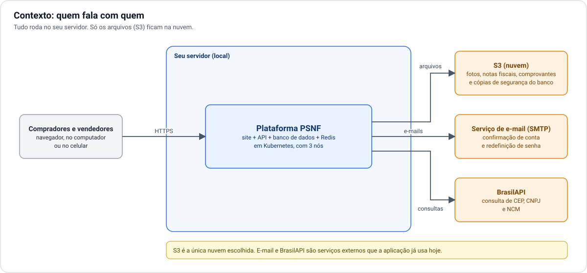
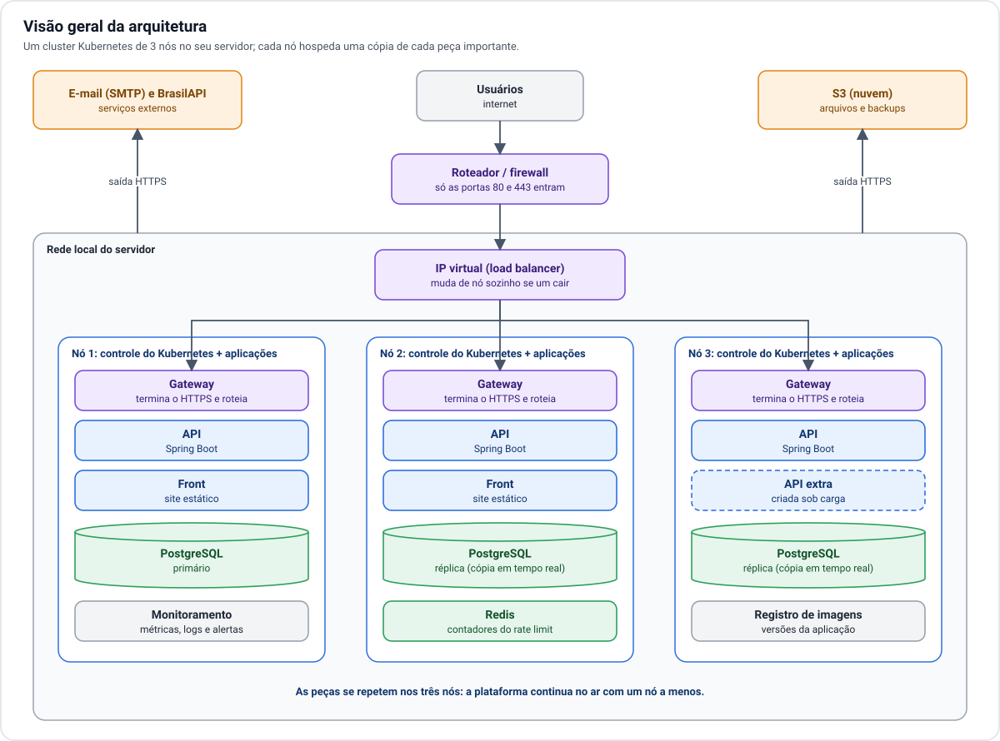

# 1. Visão geral

[← Índice](README.md) · Próximo: [2. Infraestrutura →](02-infraestrutura.md)

## O sistema e o que está em volta

Os usuários acessam a plataforma pelo navegador. Tudo o que a plataforma é (site, API, banco de dados,
Redis) roda no seu servidor. Para fora do servidor saem apenas três tipos de comunicação:

- **S3**: gravar e ler os arquivos enviados, e guardar as cópias de segurança do banco.
- **E-mail**: mensagens de confirmação de conta e de redefinição de senha.
- **BrasilAPI**: consulta de CEP, CNPJ e NCM durante cadastros.

## As peças

| Peça | O que faz | Por que existe |
| --- | --- | --- |
| **Roteador / firewall** | Recebe o tráfego da internet e deixa passar só o que é do site. | É a única porta de entrada do local. |
| **IP virtual** | Um endereço que sempre responde, não importa qual nó esteja de pé. | Faz o papel do "load balancer" que a nuvem entregaria pronto. |
| **Gateway** | Cuida do HTTPS e decide se a chamada vai para o site ou para a API. | Mantém site e API no mesmo endereço e esconde o resto do cluster. |
| **Front** | Entrega as páginas do site (arquivos estáticos). | É leve; duas cópias bastam. |
| **API** | Toda a regra de negócio: anúncios, negociações, pedidos, login. | É a peça que cresce com o número de usuários. |
| **PostgreSQL** | Guarda os dados e faz a busca de anúncios. | Três cópias, para não perder dados nem parar se um nó cair. |
| **Redis** | Conta as chamadas de cada usuário (rate limit) e as tentativas de senha. | Faz o limite valer igual em todas as cópias da API. |
| **Monitoramento** | Coleta métricas e logs e dispara alertas. | Sem nuvem, ninguém avisa por você quando algo degrada. |
| **Registro de imagens** | Guarda as versões empacotadas da aplicação. | O cluster busca as versões dali, sem depender de serviço externo. |
| **S3** | Guarda arquivos e cópias de segurança. | Único dado que fica fora do local: é a proteção contra perda total. |

## Três ideias que sustentam o desenho

**A API não guarda nada na memória que faça falta.** O login é um token que o navegador envia a cada
chamada, e a sessão longa fica no banco. Por isso qualquer cópia da API atende qualquer usuário, e criar
ou remover cópias não desloga ninguém.

**Cada peça crítica tem uma cópia por nó.** Gateway, API e banco existem nos três nós. Perder um nó
reduz a capacidade, mas não tira nenhuma função do ar.

**O que só existe uma vez pode cair sem derrubar a plataforma.** O Redis, o monitoramento e o registro
de imagens têm uma cópia só. Se o Redis cair, a API passa a contar os limites na própria memória até ele
voltar em outro nó. Os outros dois não participam do atendimento aos usuários.
