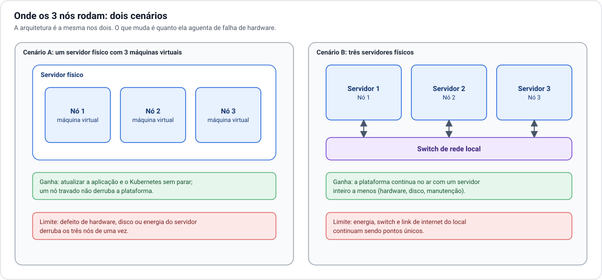
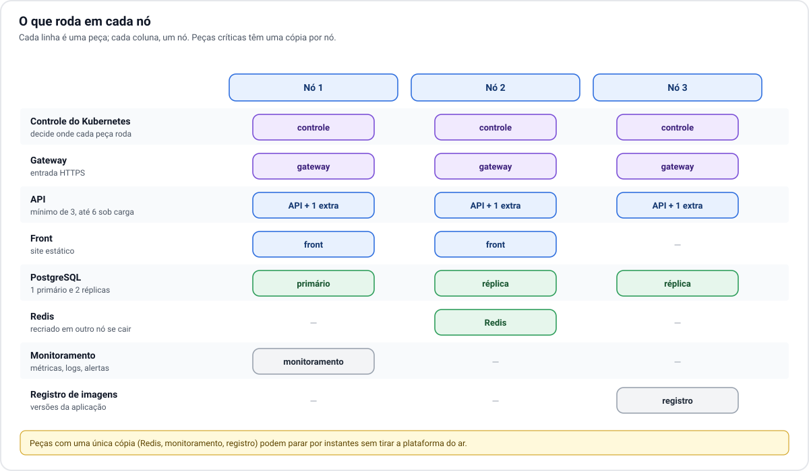

# 2. Infraestrutura

[← 1. Visão geral](01-visao-geral.md) · [Índice](README.md) · Próximo: [3. Rede e acesso →](03-rede-e-acesso.md)

## Onde os 3 nós rodam

Há dois jeitos de ter três nós, e a escolha define quanto a plataforma aguenta de falha de hardware.

| | Cenário A: 1 servidor, 3 máquinas virtuais | Cenário B: 3 servidores |
| --- | --- | --- |
| Falha de um nó (travou, atualização) | plataforma continua | plataforma continua |
| Defeito de hardware ou disco | **tudo para** | plataforma continua |
| Manutenção do servidor (trocar peça, atualizar firmware) | **exige parada** | um servidor por vez, sem parada |
| Queda de energia ou do link | tudo para | tudo para |
| Custo e complexidade | menor | maior |

O desenho lógico é o mesmo nos dois cenários. A diferença é que, no cenário A, os três nós protegem
contra falhas de **software**, mas dividem o mesmo ponto único de falha de **hardware**. Se hoje o que
existe é um único servidor, o cenário A é um bom começo, e migrar para o B depois não muda a arquitetura:
basta mover dois nós para outras máquinas.

**Qual cenário é o seu está em aberto** e é a primeira decisão a registrar em
[decisões em aberto](09-decisoes-em-aberto.md).

## Os três nós têm o mesmo papel

Em clusters grandes, alguns nós só coordenam e outros só rodam aplicações. Com três nós, essa separação
desperdiçaria máquina. Aqui **cada nó faz as duas coisas**: participa do controle do Kubernetes e roda a
aplicação.

O controle do Kubernetes decide por maioria. Com três participantes, a maioria é dois:

| Nós de pé | O que acontece |
| --- | --- |
| 3 | Operação normal. |
| 2 | Tudo funciona. O cluster recria no nó restante o que estava no nó perdido. |
| 1 | As aplicações que já estavam rodando nesse nó continuam, mas o cluster não consegue mais recriar, escalar ou atualizar nada até um segundo nó voltar. |

É por isso que três é o menor número útil: com dois nós, perder um já tira a maioria.

## O que roda em cada nó

A regra de distribuição é simples: o que atende usuário ou guarda dado fica espalhado, uma cópia por nó.
O Kubernetes cuida disso sozinho e refaz a distribuição quando um nó sai ou volta.

## Hardware sugerido

Os números abaixo são estimativas para 2.000 usuários ativos, calculadas pelo comportamento da
aplicação. Não vieram de um teste de carga. Devem ser confirmados antes da compra ou da abertura para os
usuários (ver [escalabilidade](05-escalabilidade.md)).

| Recurso | Por nó (recomendado) | Por nó (mínimo para começar) |
| --- | --- | --- |
| Processador | 8 núcleos | 4 núcleos |
| Memória | 32 GB | 16 GB |
| Disco | 500 GB SSD NVMe | 250 GB SSD |
| Rede | 1 Gbps entre os nós | 1 Gbps |

No cenário A, o servidor físico precisa da soma dos três nós mais uma folga para o sistema de
virtualização. Os discos das três máquinas virtuais devem, se possível, ficar em discos físicos
diferentes, ou em um conjunto espelhado (RAID).

**Por que disco rápido.** O banco de dados e o próprio controle do Kubernetes gravam em disco o tempo
todo e ficam lentos ou instáveis em disco mecânico.

**Por que sobra memória.** Quando um nó cai, os outros dois precisam absorver o que ele rodava. Por isso
cada nó é dimensionado para trabalhar, no dia a dia, com cerca de 60% de uso.

## Além dos nós

Itens do local que a arquitetura pressupõe e que não são Kubernetes:

- **Nobreak**, com autonomia suficiente para quedas curtas e para desligar com segurança nas longas.
- **Link de internet com IP fixo** e boa velocidade de envio (upload). Ver [rede e acesso](03-rede-e-acesso.md).
- **Switch e roteador** com capacidade de 1 Gbps.
- **Refrigeração e acesso físico controlado** ao equipamento.
