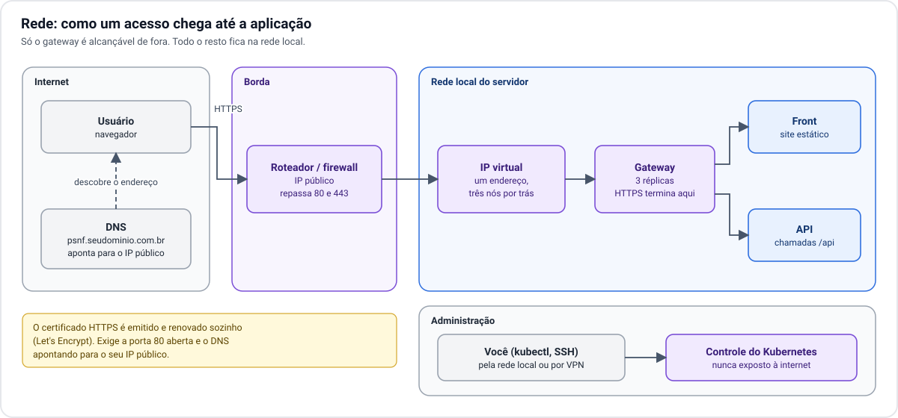
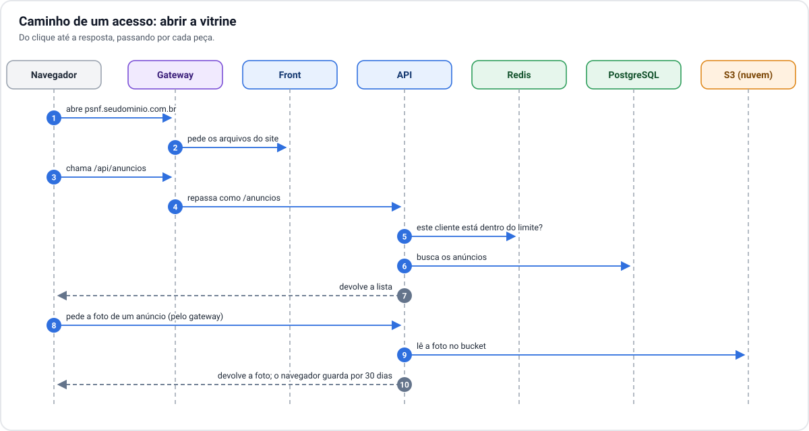

# 3. Rede e acesso

[← 2. Infraestrutura](02-infraestrutura.md) · [Índice](README.md) · Próximo: [4. Dados e arquivos →](04-dados-e-arquivos.md)

## Da internet até a aplicação

1. **DNS.** O endereço do site (por exemplo `psnf.seudominio.com.br`) aponta para o IP público do seu
   link de internet.
2. **Roteador / firewall.** Só as portas do site (80 e 443) são repassadas para dentro. Todo o resto é
   recusado.
3. **IP virtual.** Dentro da rede local, o tráfego vai para um endereço único. Esse endereço está sempre
   "em" um dos três nós; se esse nó cair, outro assume o endereço em segundos.
4. **Gateway.** Recebe a conexão, cuida do HTTPS e decide o destino: chamadas que começam com `/api` vão
   para a API; todo o resto vai para o front.

### O load balancer sem nuvem

Na nuvem, o load balancer é um serviço que se contrata. Em servidor próprio, o mesmo papel é feito por
duas peças juntas:

- o **IP virtual**, que garante que sempre existe um nó respondendo naquele endereço;
- o **gateway**, que tem uma cópia em cada nó e distribui as chamadas entre as cópias da API.

O resultado para o usuário é igual: um endereço só, que continua respondendo mesmo com um nó fora.

### HTTPS

O certificado é emitido e renovado automaticamente por uma autoridade gratuita (Let's Encrypt). Isso só
funciona se o site estiver alcançável pela internet no endereço configurado no DNS.

## Caminho de um acesso

Pontos que valem atenção no fluxo:

- **O site e a API usam o mesmo endereço.** O navegador nunca fala direto com a API em outro domínio, o
  que simplifica a segurança dos cookies de login.
- **O rate limit é conferido antes de tudo.** A API consulta o Redis antes de tocar no banco, então uma
  rajada abusiva é barrada cedo.
- **As fotos passam pela API.** A API busca a foto no S3 e a devolve. O navegador guarda cada foto por
  30 dias, então a mesma foto não é buscada de novo a cada visita.

## Administração

O acesso de administração (ao Kubernetes e aos nós) **não é exposto à internet**. É feito pela rede
local ou por uma VPN. Isso separa por completo o caminho dos usuários do caminho de quem opera.

## O link de internet é parte da arquitetura

Em servidor próprio, o link de internet vira um componente que precisa ser dimensionado.

**Velocidade de envio (upload).** Tudo o que os usuários recebem sai pelo seu link: páginas, respostas da
API e, principalmente, fotos. Um plano residencial típico tem upload baixo e pode ser o gargalo antes do
hardware.

**Tráfego das fotos conta duas vezes.** Cada foto vista pela primeira vez é baixada do S3 para o servidor
e depois enviada do servidor para o usuário.

**IP fixo.** O DNS aponta para o IP público. Com IP que muda, o site sai do ar a cada troca, a menos que
se use um serviço de DNS dinâmico.

**Ponto único de falha.** Sem um segundo link, a queda do provedor tira a plataforma do ar, por melhor
que seja o cluster.

Como ponto de partida, um link dedicado ou empresarial, simétrico, de algumas centenas de Mbps. O valor
certo deve sair da medição de uso real.
