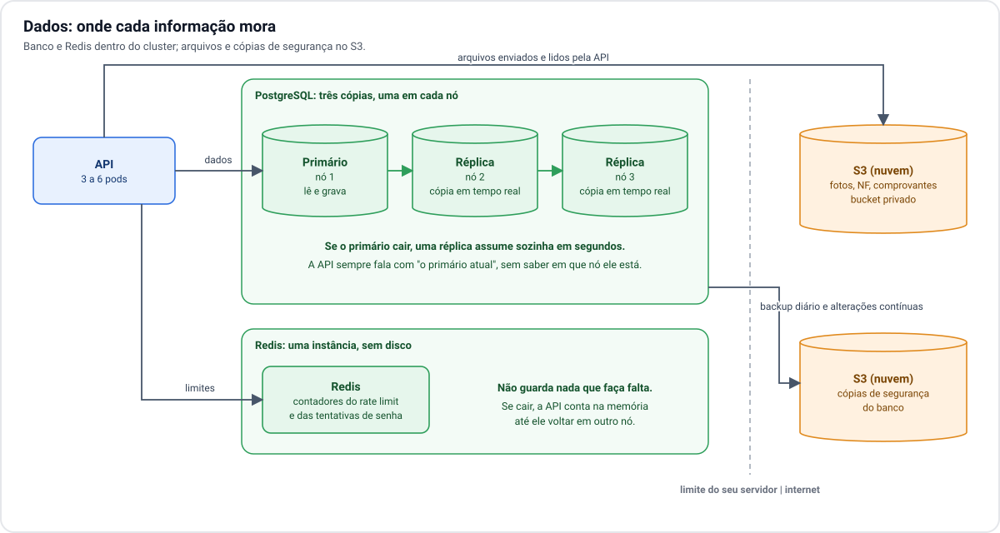
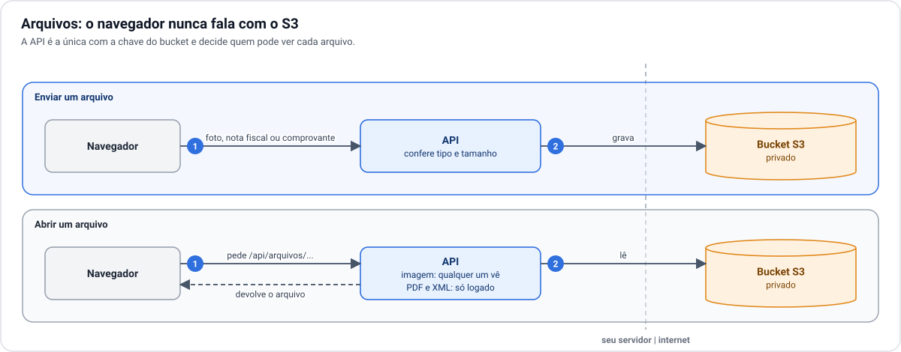
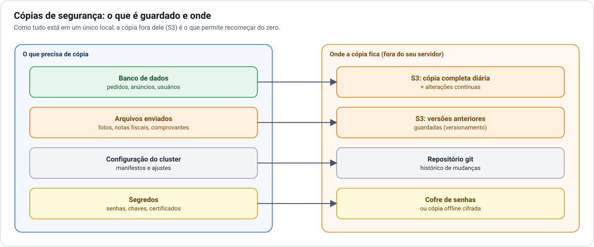

# 4. Dados e arquivos

[← 3. Rede e acesso](03-rede-e-acesso.md) · [Índice](README.md) · Próximo: [5. Escalabilidade →](05-escalabilidade.md)

A plataforma tem três tipos de dado, com exigências diferentes:

| Dado | Onde fica | Pode ser perdido? |
| --- | --- | --- |
| Usuários, anúncios, negociações, pedidos | PostgreSQL, no cluster | **Não.** É o dado mais valioso. |
| Fotos, notas fiscais, comprovantes | S3, na nuvem | **Não.** Servem de prova em pedidos. |
| Contadores do rate limit | Redis, no cluster | Sim. Recomeçam do zero sem prejuízo. |

## Banco de dados: três cópias

Sem um banco gerenciado de nuvem, a proteção vem de manter três cópias vivas dentro do cluster, uma em
cada nó:

- **Primário:** a única cópia que aceita gravação. A API fala com ela.
- **Duas réplicas:** recebem cada alteração do primário quase no mesmo instante.

Se o nó do primário cair, uma réplica é promovida a primário automaticamente. A API não precisa saber em
que nó o primário está: ela usa um endereço interno que sempre aponta para o primário do momento.

Cada cópia grava no disco local do seu próprio nó. Não é preciso um sistema de armazenamento
compartilhado entre os nós, o que elimina uma peça complexa: a duplicação dos dados é feita pelo próprio
banco.

**O que isso protege e o que não protege.** Três cópias protegem contra a perda de um nó. Não protegem
contra um erro que se replica (apagar dados por engano, uma versão com defeito) nem contra a perda do
local inteiro. Para esses casos existe a cópia de segurança.

## Redis: simples de propósito

O Redis guarda só os contadores do rate limit e das tentativas de senha. Cada contador expira sozinho.
Por isso:

- roda com **uma cópia só** e **sem gravar em disco**;
- se cair, o Kubernetes o recria em outro nó, vazio;
- enquanto ele está fora, a API continua atendendo e conta os limites na própria memória.

Não há motivo para montar alta disponibilidade para um dado que pode ser descartado.

## Arquivos no S3

O bucket é privado. Só a API tem a chave de acesso, e é ela que aplica as regras: imagens de anúncios
podem ser vistas por qualquer pessoa; notas fiscais e comprovantes só por quem está logado.

Consequências de os arquivos ficarem fora do servidor:

- **O disco dos nós não cresce com os uploads.** O volume de fotos e documentos não pressiona o hardware.
- **Depende do link.** Se a internet do local cair, o site inteiro já está fora. Se só o S3 ficar
  indisponível, a plataforma segue funcionando, mas sem mostrar nem aceitar arquivos.
- **Tem custo por uso.** Serviços de S3 cobram pelo volume guardado e pelo volume baixado. Como cada foto
  vista pela primeira vez é baixada do S3, o custo acompanha o tráfego.
- **A chave é um segredo crítico.** Sem nuvem em volta, o acesso ao bucket é por uma chave guardada no
  cluster. Ela deve ter permissão só naquele bucket.

## Cópias de segurança

Como tudo está em um único local, a regra é: **o que não pode ser perdido precisa ter uma cópia fora
dali**.

| O quê | Como | Para que serve |
| --- | --- | --- |
| Banco de dados | Cópia completa diária e envio contínuo das alterações para o S3 | Voltar o banco a qualquer momento dos últimos dias, ou reconstruí-lo do zero |
| Arquivos | Versionamento do próprio bucket | Recuperar um arquivo apagado ou sobrescrito |
| Configuração do cluster | Guardada em repositório git | Recriar o cluster igual em outro hardware |
| Segredos (senhas, chaves) | Cofre de senhas ou cópia cifrada fora do servidor | Sem eles, o backup do banco não pode ser usado |

Um backup só vale depois de testado. A restauração do banco em um ambiente separado deve ser ensaiada
antes da abertura e repetida periodicamente.
