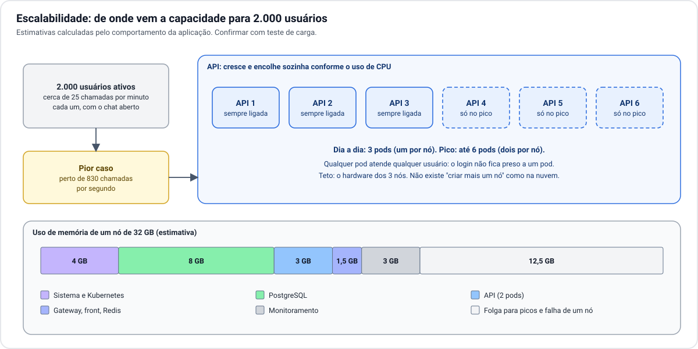

# 5. Escalabilidade

[← 4. Dados e arquivos](04-dados-e-arquivos.md) · [Índice](README.md) · Próximo: [6. Disponibilidade →](06-disponibilidade.md)

## De onde vem a carga

Um usuário com a plataforma aberta gera chamadas mesmo sem clicar: o chat consulta mensagens novas a cada
poucos segundos e os alertas são verificados a cada 30 segundos. A referência usada no próprio código é
de cerca de **25 chamadas por minuto por usuário** com o chat aberto.

Com 2.000 usuários ativos ao mesmo tempo, o pior caso fica perto de **830 chamadas por segundo**, quase
todas leituras curtas. O uso comum fica abaixo disso, porque os alertas só rodam com a aba visível e o
chat desacelera quando a conversa esfria.

Estes números são **estimativas**, não medições. A capacidade real só se conhece com um teste de carga no
hardware definitivo.

## Como cada peça acompanha a carga

| Peça | Como escala | Limite prático |
| --- | --- | --- |
| **API** | Mais cópias. O cluster cria e remove sozinho conforme o uso de processador: 3 no dia a dia, até 6 no pico. | Processador e memória livres nos nós. |
| **Gateway e front** | Trabalho leve. Três e duas cópias sobram para este volume. | Não é gargalo esperado. |
| **PostgreSQL** | Para cima: mais processador e memória no nó do primário. As réplicas não dividem a gravação. | É o gargalo mais provável a longo prazo. |
| **Redis** | Uma operação curta por chamada. Uma cópia atende com muita folga. | Não é gargalo esperado. |
| **Link de internet** | Contratando mais banda. | Pode ser o primeiro limite a aparecer. |

## O teto é o hardware

Na nuvem, quando os nós enchem, cria-se mais um nó em minutos. Em servidor próprio isso não existe: a
capacidade máxima é a soma dos três nós, e aumentá-la significa comprar e instalar equipamento.

Duas consequências para o desenho:

**Dimensionar para o pico com um nó a menos.** Se um nó cai no horário de maior uso, os outros dois
precisam segurar a carga inteira. Por isso a recomendação de hardware deixa cerca de 40% de folga em cada
nó.

**Limitar o número de cópias da API ao que o banco aguenta.** Cada cópia da API mantém um conjunto de
conexões abertas com o banco. Seis cópias com 20 conexões cada somam 120 conexões, um número confortável.
Subir muito além disso exigiria uma peça intermediária para compartilhar conexões.

## Sinais de que é hora de crescer

| Sinal | O que fazer |
| --- | --- |
| A API fica com 6 cópias por longos períodos | Mais processador nos nós, ou um quarto nó. |
| Processador do banco acima de 60% de forma constante | Mais recursos para o nó do primário; revisar consultas lentas. |
| Link de internet saturado nos horários de pico | Mais banda; avaliar guardar as fotos mais vistas no próprio servidor. |
| Respostas lentas com processador livre | Investigar banco e disco antes de comprar hardware. |

## Para além de 2.000 usuários

O desenho cresce sem ser refeito. Em ordem de esforço:

1. **Aumentar os três nós** (mais memória e processador).
2. **Adicionar nós só de aplicação**, mantendo os três originais no controle.
3. **Usar as réplicas do banco para leituras**, o que exige mudança na aplicação.
4. **Guardar fotos em cache no servidor**, para aliviar o link e o custo do S3.
