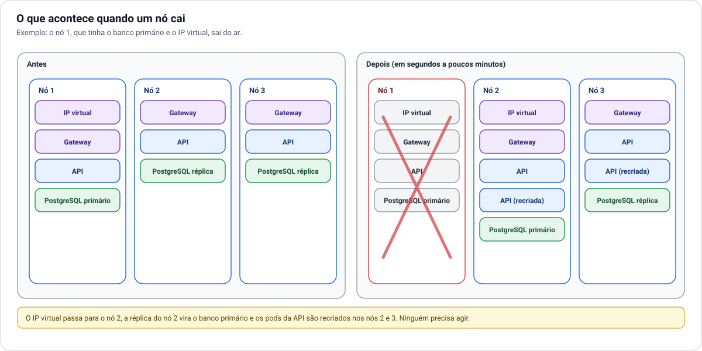

# 6. Disponibilidade

[← 5. Escalabilidade](05-escalabilidade.md) · [Índice](README.md) · Próximo: [7. Segurança →](07-seguranca.md)

## Quando um nó cai

O pior caso entre os três nós é perder aquele que tem o banco primário e o IP virtual. Mesmo assim, a
recuperação é automática:

1. **O IP virtual muda de nó** em poucos segundos. Os acessos novos já chegam a um nó saudável.
2. **Uma réplica do banco vira primário.** A API reconecta sozinha. Durante a troca, que leva de
   segundos a cerca de um minuto, as chamadas que gravam dados podem falhar e o usuário precisa repetir a
   ação.
3. **As cópias da API do nó perdido são recriadas** nos outros dois, em até alguns minutos. Enquanto
   isso, as cópias restantes atendem.

Quando o nó volta, ele entra de novo no cluster, recebe os dados que perdeu e passa a ser uma réplica do
banco.

## O que acontece em cada tipo de falha

| O que falha | Efeito para o usuário | Recuperação |
| --- | --- | --- |
| Uma cópia da API trava | Nenhum. As outras atendem. | Automática, em segundos. |
| Um nó inteiro | Lentidão breve; gravações podem falhar por até cerca de um minuto se era o nó do banco primário. | Automática. |
| Redis | Nenhum. O limite de chamadas fica menos rigoroso. | Automática. |
| Dois nós ao mesmo tempo | O que roda no nó restante continua, com capacidade reduzida e risco de sobrecarga. O cluster não se recupera sozinho. | Manual: trazer um nó de volta. |
| Serviço de S3 indisponível | Fotos e documentos não aparecem nem podem ser enviados. O resto funciona. | Quando o serviço voltar. |
| Serviço de e-mail indisponível | Novos cadastros e redefinições de senha não chegam. | Quando o serviço voltar. |
| Link de internet | **Plataforma fora do ar.** | Provedor, ou um segundo link. |
| Energia além do nobreak | **Plataforma fora do ar.** | Retorno da energia; o cluster sobe sozinho. |
| Hardware do servidor único (cenário A) | **Plataforma fora do ar.** | Conserto ou troca; se houver perda de disco, restauração a partir do S3. |
| Perda total do local (incêndio, roubo) | **Plataforma fora do ar.** | Reconstrução em outro hardware a partir do S3 e do repositório. |

## Onde estão os pontos únicos de falha

A arquitetura elimina os pontos únicos de falha **dentro do cluster**. Os que sobram estão no local:

| Ponto único | Como reduzir |
| --- | --- |
| Link de internet | Segundo link de outro provedor. |
| Energia | Nobreak; gerador, se o negócio justificar. |
| Roteador e switch | Equipamento reserva guardado no local. |
| Servidor físico (só no cenário A) | Migrar para o cenário B. |
| O local em si | Cópias no S3 e um plano de reconstrução ensaiado. |

Nenhum deles é obrigatório para começar. São riscos que você aceita ou paga para reduzir, e a tabela
serve para que essa escolha seja consciente.

## Dois números a definir

Disponibilidade se planeja a partir de dois números, que são decisão de negócio:

- **Quanto dado se aceita perder** em um desastre. Com envio contínuo das alterações do banco para o S3, a
  perda fica na ordem de minutos.
- **Quanto tempo se aceita ficar fora do ar** para reconstruir tudo do zero. Depende de haver hardware
  reserva e de o procedimento ter sido ensaiado. Sem ensaio, conte com dias, não horas.
