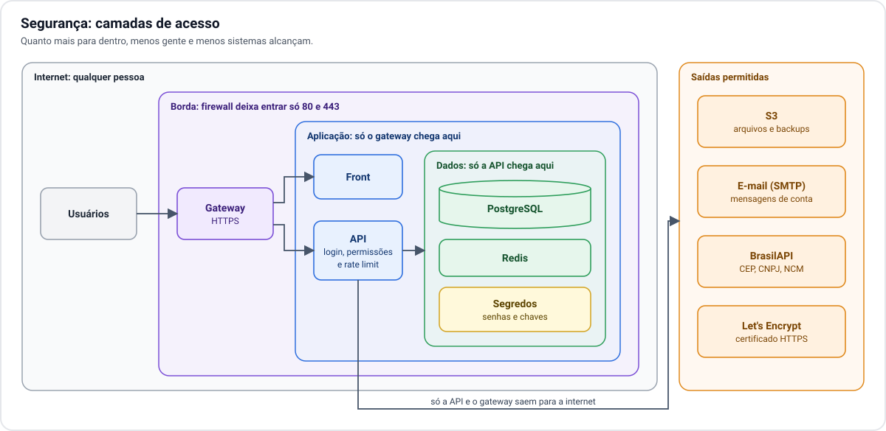

# 7. Segurança

[← 6. Disponibilidade](06-disponibilidade.md) · [Índice](README.md) · Próximo: [8. Operação →](08-operacao.md)

## Camadas

A proteção é organizada em camadas. Cada camada só é alcançada pela anterior.

| Camada | Quem alcança | O que tem |
| --- | --- | --- |
| **Internet** | Qualquer pessoa | Nada do sistema. |
| **Borda** | Internet, só pelas portas do site | Gateway (HTTPS). |
| **Aplicação** | Só o gateway | Front e API. |
| **Dados** | Só a API | PostgreSQL, Redis e os segredos. |

O banco e o Redis nunca recebem conexão de fora do cluster. Mesmo dentro dele, só a API tem permissão de
falar com os dois.

## O que a aplicação já faz

A arquitetura se apoia em proteções que já existem no código:

- **Login** por token em cookie que o JavaScript da página não consegue ler.
- **Rate limit** em todas as rotas, por usuário logado ou por endereço IP, agora com contadores no Redis
  e por isso igual em todas as cópias da API.
- **Freio de tentativas de senha** por e-mail.
- **Arquivos privados**: documentos só são entregues a quem está logado.
- **Registro de auditoria** de eventos de conta.

## O que a infraestrutura acrescenta

- **Só duas portas abertas** para a internet.
- **HTTPS em tudo**, com certificado renovado automaticamente.
- **Administração fora da internet**, por rede local ou VPN.
- **Saída controlada**: do cluster para fora, só os destinos necessários (S3, e-mail, BrasilAPI e a
  autoridade do certificado).
- **Segredos fora do código**: senhas do banco, chave do S3 e a chave que assina os logins ficam
  guardadas no cluster e não no repositório.

## Cuidados próprios de um servidor em casa ou no escritório

Em nuvem, parte da segurança é do provedor. Em servidor próprio, ela passa a ser sua:

- **Acesso físico.** Quem alcança o equipamento alcança os dados. Vale cifrar os discos.
- **Rede compartilhada.** O ideal é o servidor ficar em uma rede separada dos computadores e celulares do
  local, para que um aparelho comprometido não enxergue o cluster.
- **Atualizações.** Sistema dos nós, Kubernetes e roteador precisam de atualização periódica. Com três
  nós, dá para atualizar um por vez sem parar.
- **IP exposto.** O endereço do seu link fica público no DNS. Ataques de volume contra ele derrubam o
  link, e o cluster não tem como se defender disso sozinho.
- **A chave do S3.** Deve dar acesso só ao bucket da plataforma, e ser trocada se houver suspeita de
  vazamento.
