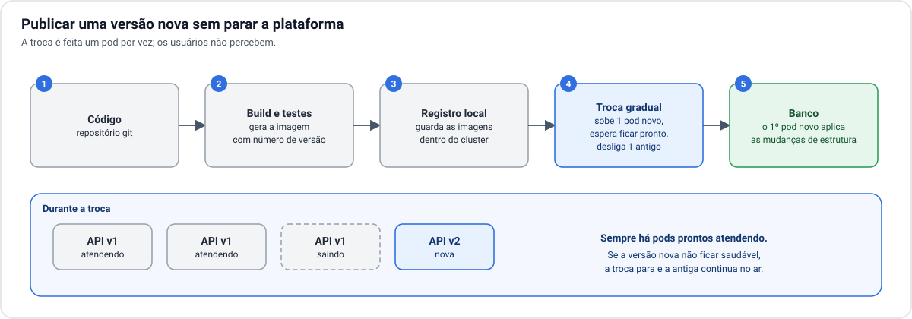

# 8. Operação

[← 7. Segurança](07-seguranca.md) · [Índice](README.md) · Próximo: [9. Decisões em aberto →](09-decisoes-em-aberto.md)

## Publicar uma versão nova

1. O código é empacotado em uma **imagem** com número de versão.
2. A imagem vai para o **registro local**, dentro do cluster.
3. O cluster troca as cópias da API **uma por vez**: sobe uma nova, espera ela responder, desliga uma
   antiga. Em nenhum momento faltam cópias atendendo.
4. A primeira cópia nova aplica as **mudanças de estrutura do banco**, se houver. As demais esperam.

Se a versão nova não ficar saudável, a troca para sozinha e a versão antiga continua no ar. Voltar à
versão anterior é o mesmo processo no sentido contrário.

Um cuidado: durante a troca, cópias antigas e novas convivem com o mesmo banco. Mudanças que removem ou
renomeiam colunas precisam ser feitas em duas versões seguidas.

## Monitoramento

Sem nuvem, não há painel pronto nem alerta de fábrica. O monitoramento roda no próprio cluster e precisa
cobrir quatro perguntas:

| Pergunta | O que observar |
| --- | --- |
| Está no ar? | Teste externo do endereço do site, feito de **fora** do local. |
| Está saudável? | Cópias da API reiniciando, erros nas respostas, tempo de resposta. |
| Está perto do limite? | Uso de processador, memória e disco dos nós; conexões do banco; uso do link. |
| Os dados estão protegidos? | Réplicas do banco em dia; último backup concluído; validade do certificado. |

O teste "está no ar?" precisa vir de fora. Se a energia ou o link caírem, o monitoramento interno cai
junto e não avisa ninguém.

## Rotina

| Frequência | Tarefa |
| --- | --- |
| Contínua | Alertas chegando a alguém que possa agir. |
| Semanal | Conferir se os backups do banco estão sendo concluídos. |
| Mensal | Atualizar os nós, um por vez. Revisar uso de disco e de link. |
| Trimestral | Ensaiar a restauração do banco em ambiente separado. |
| Anual | Ensaiar a reconstrução completa; revisar nobreak e equipamentos reserva. |

## Ambiente de testes

Um ambiente de homologação pode viver no mesmo cluster, isolado do de produção, usando outro banco e
outro bucket. Ele consome recursos dos mesmos três nós, então deve ser pequeno e pode ficar desligado
fora do uso.

## Quem opera

Esta é a maior diferença em relação à nuvem. Banco, backups, atualizações, energia e rede passam a ter um
responsável: você ou alguém designado. A arquitetura automatiza a recuperação das falhas comuns, mas as
falhas do local (link, energia, hardware) dependem de uma pessoa.
