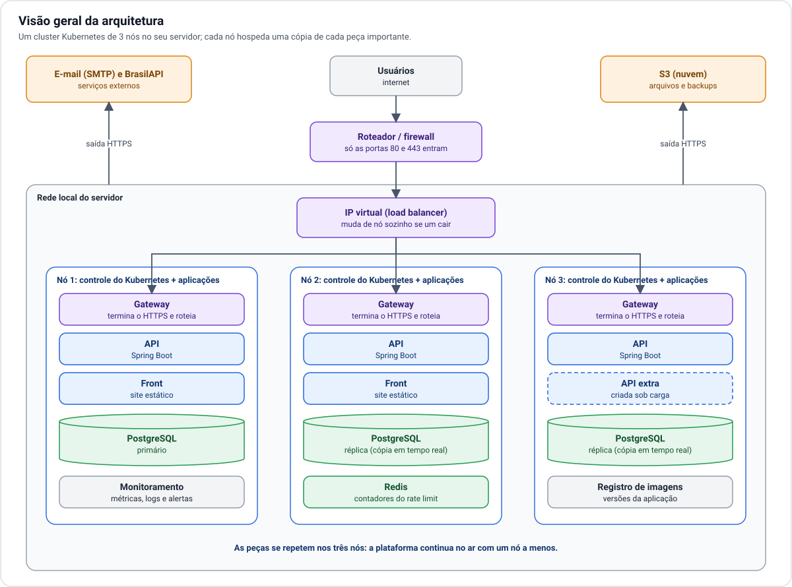

# Arquitetura da PSNF em servidor próprio

Documentação da arquitetura proposta para rodar a PSNF **no seu próprio servidor**, em um cluster
Kubernetes de **3 nós**, com capacidade para **até 2.000 usuários ativos**. A única parte na nuvem é o
**S3**, que guarda os arquivos enviados e as cópias de segurança.

Este material explica o desenho e os motivos. Não traz comandos nem configuração: os detalhes de
implementação entram depois.

## Como ler

| Documento | Responde a |
| --- | --- |
| [1. Visão geral](01-visao-geral.md) | Quais são as peças e como elas se ligam? |
| [2. Infraestrutura](02-infraestrutura.md) | Onde os 3 nós rodam, o que há em cada um e que hardware é preciso? |
| [3. Rede e acesso](03-rede-e-acesso.md) | Como um usuário na internet chega até a aplicação? |
| [4. Dados e arquivos](04-dados-e-arquivos.md) | Onde ficam o banco, o Redis, os arquivos e os backups? |
| [5. Escalabilidade](05-escalabilidade.md) | Como a plataforma aguenta 2.000 usuários e qual é o teto? |
| [6. Disponibilidade](06-disponibilidade.md) | O que acontece quando algo quebra? |
| [7. Segurança](07-seguranca.md) | O que fica exposto e o que fica protegido? |
| [8. Operação](08-operacao.md) | Como publicar versões, monitorar e manter? |
| [9. Decisões em aberto](09-decisoes-em-aberto.md) | O que ainda precisa ser decidido por você? |

## Premissas

Estas premissas guiaram o desenho. Se alguma estiver errada, os documentos afetados estão indicados.

| Premissa | Se for diferente |
| --- | --- |
| As "3 instâncias de Kubernetes" são **3 nós de um mesmo cluster**, não 3 clusters separados. | Muda o desenho inteiro; avise antes de seguir. |
| Os 3 nós ficam **no mesmo local** (mesma sala, mesma rede, mesmo link de internet). | Com mais de um local, muda a parte de [rede](03-rede-e-acesso.md) e de [disponibilidade](06-disponibilidade.md). |
| Banco de dados e Redis rodam **dentro do cluster**, já que não há serviço gerenciado de nuvem. | Com um servidor de banco separado, muda a parte de [dados](04-dados-e-arquivos.md). |
| O S3 é usado para os **arquivos** e também para as **cópias de segurança** do banco. | Sem backup no S3, é preciso outro destino fora do servidor. |
| Além do S3, a aplicação já depende de dois serviços externos: **envio de e-mail** e **BrasilAPI**. | Ver [decisões em aberto](09-decisoes-em-aberto.md). |

## Resumo em cinco pontos

1. **Três nós iguais.** Cada nó participa do controle do Kubernetes e também roda a aplicação. A
   plataforma continua no ar com um nó a menos.
2. **Uma entrada só.** Um endereço IP virtual, que pula de nó sozinho, recebe todo o tráfego e o entrega a
   um gateway que cuida do HTTPS.
3. **API sem estado, de 3 a 6 cópias.** Cresce e encolhe conforme o uso. O teto é o hardware dos três nós.
4. **Banco com três cópias.** Um PostgreSQL primário e duas réplicas, um por nó, com troca automática se o
   primário cair. Cópia de segurança contínua no S3.
5. **O risco que sobra é o local.** Energia, link de internet e, se os 3 nós forem máquinas virtuais em um
   único servidor, o próprio hardware. A cópia no S3 é o que permite reconstruir tudo.

## Relação com o outro guia

O arquivo [`README-KUBERNETES.md`](../../README-KUBERNETES.md), na raiz, descreve uma implantação **em
nuvem (AWS)** e traz comandos e manifestos. Ele não é o caminho escolhido. A arquitetura em vigor é a
deste diretório; as partes daquele guia que não dependem de nuvem (imagens, configuração da API, rotas)
podem ser reaproveitadas na fase de implementação.
